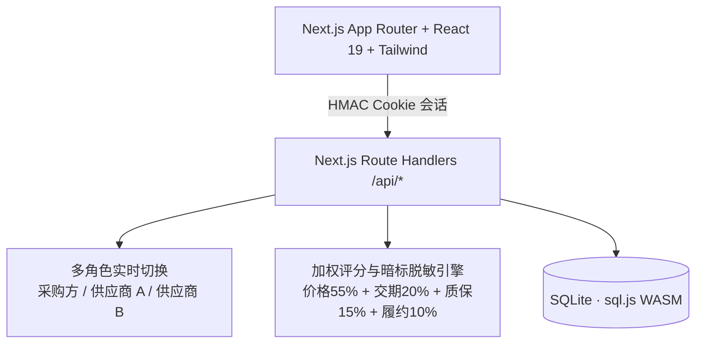

# 易采协同台 · SupplyFlow Bidding

[](https://github.com/calmjade/supplyflow-bidding/actions/workflows/ci.yml)


面向制造与产业互联网企业的**供应链询报价（RFQ）与多角色在线竞价协同全栈系统**。支持采购方与多家合格供应商在统一工作台内完成需求发标、暗标脱敏竞价、多维度综合评分比价、一键定标与采购降本分析全流程。

- 🌐 **在线体验**：[https://calmjade.cn/supplyflow](https://calmjade.cn/supplyflow)
- 🏠 **作者作品集**：[https://calmjade.cn](https://calmjade.cn)

---

## 系统架构



---

## 核心特性

- **实时多角色工作台切换**：基于 HMAC-SHA256 签名 `HTTP-only Cookie` 会话机制，一键切换采购方与多家供应商视角，30 秒内体验完整发标 → 报价 → 定标闭环。
- **暗标保护与多维评分定标**：供应商视角自动脱敏竞争对手报价与方案；采购方视角计算预算节约率与加权综合得分，支持一键定标。
- **零原生依赖持久化**：采用 `sql.js`（WASM SQLite）自动持久化至 `./data/supplyflow.sqlite`。

---

## 快速开始与测试

```bash
pnpm install
pnpm test    # 运行评分与脱敏算法 Vitest 单测
pnpm dev     # 启动全栈开发服务（端口 9024）
```

---

## 作者与许可

- **作者**：曹杰 / caojie (`calmjade`) · calmjade@foxmail.com
- **GitHub**：[https://github.com/calmjade](https://github.com/calmjade)
- **开源协议**：[MIT License](./LICENSE)
